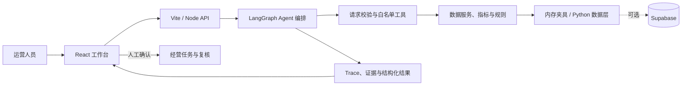

# 莱森购 Retail Intelligence Agent

**面向无人零售运营的经营诊断与行动闭环 Demo。** 将门店经营指标、规则审计、区域选址、Agent 分析和任务复核放进同一个工作台，让运营人员从“发现异常”走到“采取行动并检查结果”。

> 当前仓库提供可本地运行的端到端演示实现，采用长春门店及区域样例数据。它适合产品演示、流程验证和工程原型评估；真实 IoT 接入、用户认证、多租户隔离和生产级运维尚未完成。

## 产品闭环

```text
提出经营问题
    -> Agent 按白名单规划分析工具
    -> 查询指标、规则结果、可比基线与选址数据
    -> 展示结论、限制条件、证据和执行轨迹
    -> 人工确认行动建议并推进任务
    -> 下一周期复核，关闭或升级
```

系统用确定性数据服务和规则计算形成经营事实，Agent 负责组织分析、解释结果和提出建议。证据不足或关键数据缺失时，界面保留“证据不足 / 无法判断”的状态，不把它伪装成正常结论；需要写入任务的操作由人工确认。

## 当前功能

- **经营驾驶舱与风险地图**：查看销售额、设备在线情况、盘点差异、待处理事项和门店风险；支持门店筛选、搜索和详情查看。
- **门店对标与审计**：比较同区域门店的销售、订单、客单价、退款和设备指标；展示异常规则、证据、数据缺失保护和审计轨迹。
- **区域投放决策**：按区域指标与成本输入展示评分、收益估算和回本周期；缺少成本或可比数据时保留无法估算状态。
- **经营行动中心**：查看任务及状态，推进调查、提交证据，并根据复核结果关闭或升级。
- **自然语言经营顾问**：在主界面或“莱财”头像气泡中提问，查看思考步骤、结构化结论、决策依据与待确认建议。支持 OpenAI 兼容接口及 Anthropic 接口；未配置模型或调用失败时使用确定性规划与总结回退。
- **Agent 检测工作台**：检查规划合同、工具调用、证据校验、结构化输出和 API 契约。
- **Agent 主动监控演示**：模拟设备心跳、离线告警、通知、升级、确认与恢复流程；支持 Webhook 和邮件通知配置。
- **可选 Python 数据层与 Supabase**：本地夹具可脱离数据库运行；也可部署 Supabase，为经营数据、Wiki、任务和 trace 提供持久化存储。

## 技术栈

- **前端**：React、Vite、React Leaflet、Lucide React、原生 CSS
- **Agent**：LangGraph、LangChain Core、白名单工具注册、结构化输出与安全门禁
- **服务端**：Node.js、Vite middleware、统一 JSON API
- **数据层**：Python 标准库 HTTP 服务、指标与规则服务、Supabase PostgreSQL/PostgREST
- **工程保障**：Zod/契约校验、trace 记录、离线 fixture、Agent 与监控回归脚本

## 快速开始

### 环境要求

- Node.js 18 或更高版本
- npm
- Python 3.10+ 仅在运行 Python 数据层或 Supabase 工具时需要

### 启动前端与 API

```bash
npm install
npm run dev
```

打开 Vite 输出的本地地址。Vite 开发服务器同时挂载 `/api/v1/*` API；没有 Python 服务或 Supabase 时，应用会通过内置的内存样例数据继续运行。

### 可选：运行 Python 离线数据层

在第二个终端执行：

```bash
python -m pip install -r requirements.txt
python -m data_layer.server --offline
```

离线模式使用仓库内置夹具，不连接 Supabase。它适合验证 Node API 到 Python 数据层的调用链；该模式和前端内存回退是两种不同的数据路径。

### 可选：配置模型

将 `.env.example` 复制为根目录 `.env`，填入你自己的模型服务商、基础地址、模型名称和 API 密钥，然后重启开发服务器。支持的配置项见 `.env.example` 与 `src/agent/components/llmClient.js`。

**不要使用或提交仓库历史中出现过的示例密钥。** 请填写自己新生成的密钥，并确保 `.env` 不进入 Git。未配置有效密钥时，Agent 会使用确定性回退逻辑，应用的基本演示流程仍可使用。

Webhook、邮件通知和数据层开关也是可选环境配置，字段说明见 `.env.example`、[主动监控说明](./docs/monitor-loop.md) 和 [部署手册](./docs/DEPLOYMENT.md)。

## 常用命令

| 命令 | 用途 |
| --- | --- |
| `npm run dev` | 启动本地前端与 API 开发服务器 |
| `npm run build` | 构建生产静态资源 |
| `npm run preview` | 预览生产构建；Vite 插件仍提供 API 路由 |
| `npm run build && npm run start` | 构建后使用单端口生产入口启动；默认端口 `4173`，可用 `PORT` 覆盖 |
| `npm run validate:contracts` | 验证共享 API 契约与 fixture |
| `npm run test:agent` | 验证 Agent 分层、工具规划和输出保护 |
| `npm run test:monitor-loop` | 验证主动监控状态机和通知闭环 |
| `python tools/verify_local.py` | 离线验证 Python 数据层指标、规则与区域计算 |

生产入口需要先生成 `dist/`。线上部署还需按环境配置模型服务、数据源和通知服务，不能仅凭 `npm run build` 视为完成生产配置。

## 架构概览



主要目录：

```text
src/
  main.jsx, pages/       React 主界面与驾驶舱、区域、审计、行动页面
  agent/                 Agent 定义、LangGraph 编排、安全门禁与监控 Loop
  server/                Node API、数据层桥接和 trace 记录
  services/              指标、规则、区域评分和数据管道
  ui/                    共享界面原子组件
  fixtures/               契约 fixture
data_layer/               Python 数据访问、领域服务、规则和任务状态机
contracts/                 共享类型、JSON 契约与验收 fixture
configs/                   指标与评分配置
supabase/                  数据库 schema 与部署脚本
docs/                      API、部署、监控和演示文档
scripts/                   契约、Agent 和监控回归验证
output/                    项目演示材料与图像资源
```

## API 与数据链路

主要 API 由 `src/server/api.js` 提供，统一以 `/api/v1` 为前缀：

- `GET /api/v1/operations/overview`：主界面经营总览
- `GET /api/v1/dashboard`、`GET /api/v1/audit`、`GET /api/v1/regions`：驾驶舱、审计与区域数据
- `POST /api/v1/agent/run`：运行自然语言经营分析
- `/api/v1/operations/task-action`：推进经营任务与复核
- `/api/v1/agent/monitor/*`：设备离线、心跳、确认和恢复演示接口

完整请求和响应格式见 [API 契约](./docs/API_CONTRACT.md)。Python 数据层与 Supabase 的安装、建库和连接步骤见 [部署手册](./docs/DEPLOYMENT.md)。

## 演示路径

1. 在驾驶舱搜索或选择门店，打开详情查看经营趋势、风险状态和同区基线。
2. 通过“同城门店对标”比较异常店与可比样本，检查证据和缺失数据保护。
3. 在“区域投放决策”查看评分与投资回本估算，并留意数据不足时的空值保护。
4. 点击“莱财”头像或使用经营顾问输入问题，检查结构化结论、分析步骤与待审核决策。
5. 在“经营行动中心”人工确认并推进任务，再通过下一周期复核关闭或升级。
6. 在“Agent 主动监控”模拟设备离线、通知升级、人工确认和设备恢复。

两分钟讲解稿见 [项目路演脚本](./docs/PPT_2MIN_SCRIPT.md)，项目路演文件位于 [`output/`](./output/)。

## 当前边界

- 演示门店、区域和设备数据是样例数据，不代表真实运营事实。
- 未配置外部 LLM 时，Agent 以确定性规划和总结逻辑回退；外部模型输出仍受白名单、请求合同和证据检查约束。
- Python 数据层的 `--offline` 模式使用内置夹具；Supabase 持久化需要单独部署并配置服务端凭据。
- Agent 主动监控目前以本地 Demo 状态和模拟设备为主，尚未接真实 IoT 网关、消息队列或生产告警服务。
- 当前 Demo 未实现登录、用户权限和多租户隔离，不应直接作为生产系统对外开放。

## 文档

- [产品范围与验收说明](./PROJECT.md)
- [技术架构](./TECHNICAL_ARCHITECTURE.md)
- [API 契约](./docs/API_CONTRACT.md)
- [数据库与 Wiki 规范](./docs/DATABASE_AND_WIKI_SPEC.md)
- [部署与数据层手册](./docs/DEPLOYMENT.md)
- [主动监控 Loop](./docs/monitor-loop.md)
- [两分钟项目路演脚本](./docs/PPT_2MIN_SCRIPT.md)
