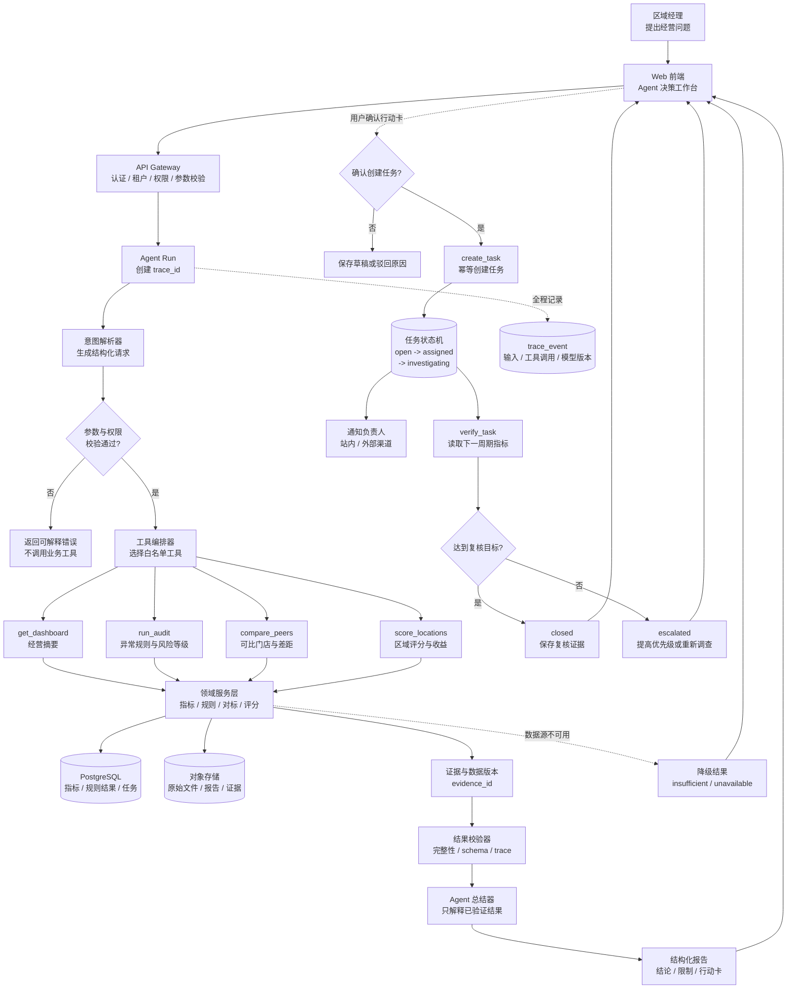

# 莱森购 Retail Intelligence Agent 技术架构

## 1. 文档目的

本文定义莱森购无人零售经营智能决策平台的生产级前后端分离架构，同时标注当前 Demo 与目标架构的差异。

- 当前实现：React + Vite 单页 Demo，本地模拟门店数据，地图、对标和风险案件均在前端完成。
- 目标实现：React Web 前端、独立后端 API、领域服务、持久化数据和受约束的 Agent 工具调用。
- 第一阶段后端形态：模块化单体，保持一个 API 服务和清晰模块边界；业务稳定后再按负载拆分服务。

## 2. 架构目标与约束

### 目标

1. 让区域经理从经营问题进入，完成分析、决策、任务派发和结果复核。
2. 让每个数字、规则和 Agent 结论都能追溯到数据版本、证据和处理记录。
3. 让前端只负责展示与交互，关键指标和风险判定由后端确定性计算。
4. 让 Agent 能调用业务工具，但不能直接访问数据库、修改规则或执行高风险动作。
5. 支持从模拟数据平滑迁移到真实数仓和外部数据接口。

### 约束

- 当前 Demo 仍需使用 `npm run dev` 启动，不要求本轮实现后端。
- 生产系统采用 API 前后端分离，不依赖前端内存作为事实数据源。
- 先采用模块化单体，不提前引入微服务、消息队列和复杂编排。
- LLM 只处理意图理解、工具编排和自然语言总结；指标、规则和评分由代码完成。

## 3. 总体架构

```text
┌─────────────────────────────────────────────────────────┐
│ Web 前端                                                │
│ React + TypeScript + Vite                               │
│ 驾驶舱 / 审计 / 区域投放 / Agent 工作台 / 行动中心      │
└──────────────────────┬──────────────────────────────────┘
                       │ HTTPS / JSON / SSE
┌──────────────────────▼──────────────────────────────────┐
│ API 服务（模块化单体）                                  │
│ 认证授权 · 查询 API · 命令 API · Agent 编排             │
│ 仪表盘 · 审计 · 对标 · 区域评分 · 案件 · 任务 · 报告   │
└──────────────┬───────────────┬─────────────────────────┘
               │               │
┌──────────────▼──────┐ ┌──────▼────────────────────────┐
│ 领域服务              │ │ Agent 适配层                  │
│ 指标 / 规则 / 对标    │ │ 白名单工具 / JSON Schema     │
│ 评分 / 复核           │ │ 模型供应商 / Prompt 版本      │
└──────────────┬──────┘ └──────┬────────────────────────┘
               │               │
┌──────────────▼────────────────▼────────────────────────┐
│ 数据与基础设施                                            │
│ PostgreSQL · 对象存储 · Redis（可选）· 外部数据适配器      │
│ 数据版本、证据、trace、报告和任务状态                      │
└─────────────────────────────────────────────────────────┘
```

推荐后端使用 Node.js + TypeScript 的模块化单体（NestJS/Fastify 均可），因为当前前端已经是 JavaScript/Node 工具链，能够共享类型、校验器和开发环境。实际框架以团队已有规范为准，不影响本文的模块边界。

### 3.1 一次经营问题的完整处理流程

下面流程图展示用户从提出问题到完成任务复核时，各层之间的调用关系。实线表示系统调用，虚线表示需要人工确认或异步通知的步骤。



流程中的关键控制点：

- `API Gateway` 在进入 Agent 前完成身份、租户、区域和参数校验。
- `工具编排器` 只能从登记的工具清单中选择调用目标。
- 领域服务先计算指标和证据，Agent 只能总结已验证的结果。
- 创建任务是有状态写操作，必须经过用户确认并使用幂等键。
- 数据不足、外部数据不可用或工具失败时返回降级状态，不生成确定性结论。
- `trace_event` 覆盖整个流程，保证问题、工具调用、数据版本、模型版本和最终任务可以回放。

## 4. 前端架构

### 4.1 页面与路由

生产前端拆成以下路由，当前 Demo 的地图、对标和案件抽屉对应其中一部分：

```text
/dashboard                 经营驾驶舱
/audits                    智能审计中心
/audits/:auditId           审计详情
/locations                 区域投放决策
/agent                     Agent 决策工作台
/tasks                     经营行动中心
/tasks/:taskId             任务详情与复核
/reports/:reportId         报告详情
```

### 4.2 前端分层

```text
src/
  app/                 路由、布局、认证上下文
  pages/               页面级容器
  components/          表格、指标卡、地图、状态、证据组件
  services/api/        API client、SSE、错误转换
  features/            dashboard、audit、location、agent、task
  state/               查询缓存和短期界面状态
  contracts/           与后端共享的请求/响应类型
  styles/              全局主题和组件样式
```

前端不计算风险等级、不生成基准中位数、不直接拼装审计结论。前端展示后端返回的 `value`、`unit`、`evidence_ids`、`trace_id` 和状态。

### 4.3 数据请求原则

- 查询使用带区域、时间窗口和数据版本的 GET API。
- 创建案件、创建任务、确认任务等改变状态的操作使用 POST/PATCH API。
- Agent 长任务使用 SSE 或轮询展示工具调用进度；最终结果仍保存为结构化报告。
- 统一处理加载、空数据、权限不足、数据不可判定和后端错误状态。

## 5. 后端模块

### 5.1 API 层

API 层负责认证、参数校验、权限检查、分页、错误码和响应格式，不承载指标计算。

主要资源：

```text
GET  /api/v1/dashboard
GET  /api/v1/audits
POST /api/v1/audits/run
GET  /api/v1/benchmarks
POST /api/v1/location-scores
POST /api/v1/agent/runs
GET  /api/v1/agent/runs/:runId/events
POST /api/v1/tasks
PATCH /api/v1/tasks/:taskId
POST /api/v1/tasks/:taskId/verify
GET  /api/v1/reports/:reportId
```

所有请求携带 `tenant_id`、操作者身份、区域范围和数据版本；后端从认证上下文取得租户和权限，不信任前端传入的身份字段。

### 5.2 领域模块

```text
dashboard        汇总经营指标和待办数量
audit            审计运行、异常结果和证据集合
metric           指标公式、聚合和单位校验
benchmark        可比门店、基准、排名和差距拆解
location         区域评分、收益测算和敏感项
case             风险案件状态和处置记录
task             行动卡、负责人、期限和复核
report           JSON/Markdown 报告生成
trace            输入、版本、工具调用和输出记录
identity         用户、角色、区域权限和租户隔离
```

这些模块在第一阶段位于同一进程，但只能通过模块接口调用，不能跨模块直接访问数据库表。

### 5.3 数据存储

- **PostgreSQL**：业务数据索引、指标结果、案件、任务、报告元数据和审计日志。
- **对象存储**：原始文件、导入批次、报告附件和大体积证据。
- **Redis（可选）**：短期查询缓存、Agent 运行状态和幂等锁，不保存唯一事实数据。
- **外部数据适配器**：地理、客流、竞品或产业数据，统一转成内部数据契约。

关键实体：`tenant`、`user`、`store`、`data_batch`、`metric_snapshot`、`audit_run`、`evidence`、`case`、`task`、`task_verification`、`agent_run`、`tool_call`、`report`、`trace_event`。

## 6. Agent 架构

### 6.1 为什么使用白名单工具 + 结构化 JSON

这不是为了限制 Agent 的表达能力，而是为了把模型放在适合它的位置：

1. **安全边界**：模型只能调用预先登记的工具，不能自由写 SQL、访问任意表或执行未授权动作。
2. **确定性判断**：退款率、排名、风险级别和区域评分由代码计算，同样输入可以得到同样结果。
3. **可审计**：工具名、参数、结果、证据、模型版本和提示词版本都可以保存并回放。
4. **前后端可协作**：JSON 可以直接被前端渲染成指标、证据、行动卡和任务状态，不需要解析自然语言。
5. **模型可替换**：更换模型供应商不会改变领域服务和前端接口。

### 6.2 Agent 调用流程

```text
用户问题
  -> 意图解析（只生成结构化请求）
  -> 参数校验和权限检查
  -> 选择白名单工具
  -> 执行指标/审计/对标/评分工具
  -> 校验工具结果和证据完整性
  -> 生成摘要与行动建议
  -> 用户确认后创建任务
```

Agent 不直接创建高风险任务。涉及外部经营动作时，必须先生成待确认行动卡，由用户确认后调用 `create_task`。

### 6.3 工具接口

工具统一返回结构化结果：

```json
{
  "tool_call_id": "call_001",
  "status": "succeeded",
  "data": {},
  "evidence_ids": ["ev_001"],
  "data_version": "demo_v1",
  "trace_id": "trace_001",
  "warnings": []
}
```

核心工具：

| 工具 | 作用 | 是否改变状态 |
|---|---|---:|
| `get_dashboard` | 查询经营摘要 | 否 |
| `run_audit` | 按固定规则运行审计 | 否 |
| `compare_peers` | 计算可比门店和差距 | 否 |
| `score_locations` | 计算区域评分和收益 | 否 |
| `create_task` | 创建已确认的行动任务 | 是 |
| `verify_task` | 根据复核指标关闭或升级任务 | 是 |
| `write_report` | 保存结构化报告 | 是 |

## 7. 核心契约

### 指标结果

```json
{
  "metric_id": "refund_rate",
  "value": 7.0,
  "unit": "percent",
  "scope": { "store_id": "A", "region": "朝阳区" },
  "window": { "from": "2026-10-12", "to": "2026-10-18" },
  "data_version": "demo_v1",
  "evidence_ids": ["ev_refund_001"]
}
```

### 行动任务

任务必须包含问题、证据、动作、负责人、截止时间、复核指标和状态。状态只能通过后端状态机迁移：

```text
open -> assigned -> investigating -> verifying -> closed
                                  └──────────> escalated
```

### 数据不足

少于 3 家可比门店、关键字段缺失或数据版本不一致时，返回 `insufficient` 或 `unavailable`，不得生成确定性根因和高优先级任务。

## 8. 安全、可靠性与可观测性

- 使用 OIDC/OAuth2 登录，后端按租户、角色和区域执行权限检查。
- 所有写操作要求幂等键，避免重复建案和重复派发任务。
- 记录 API 请求、Agent run、tool call、规则版本、数据版本、模型版本和用户确认。
- 原始数据只读保存；报告和摘要不能覆盖原始证据。
- 对 LLM 输入做字段裁剪和脱敏，禁止把无关个人信息发送给模型。
- 监控 API 延迟、工具失败率、Agent 完成率、证据缺失率和任务复核率。
- 外部模型或数据源不可用时，系统返回可解释的降级状态，不伪造结果。

## 9. 部署拓扑

```text
CDN / WAF
  -> Web 静态资源
  -> API Gateway / Load Balancer
       -> API 服务副本（无状态）
            -> PostgreSQL
            -> Redis（可选）
            -> 对象存储
            -> LLM Gateway
            -> 外部数据适配器
```

前端静态资源和 API 独立发布。配置、密钥和模型供应商凭据只能通过部署环境注入，不能写入前端代码或仓库。

## 10. 演进路径

1. **当前 Demo**：保留 `src/main.jsx` 的本地数据和交互，完成视觉与演示验证。
2. **数据层抽离**：将门店数据、指标公式和规则移到后端模块，前端改为 API 查询。
3. **Agent 接入**：实现结构化 Agent run、白名单工具和 SSE 进度流。
4. **闭环持久化**：落地案件、任务、证据、trace 和复核状态。
5. **生产接入**：增加认证、租户隔离、真实数据源、部署监控和备份。
6. **按需拆分**：只有在数据处理、Agent 执行或通知负载明确超过模块化单体能力时，才拆分独立服务。

## 11. 验收标准

- 前端可以通过 API 加载驾驶舱、审计、对标、区域评分和任务数据。
- 同一数据版本下，指标和规则结果可重复计算。
- Agent 只能调用登记工具，工具参数和返回值通过 schema 校验。
- 每个结论至少关联一个证据 ID 和 trace ID。
- 没有足够可比数据时，系统明确返回证据不足。
- 创建任务必须经过用户确认，任务状态只能按状态机迁移。
- 模型不可用时，指标和审计结果仍可用，Agent 摘要显示降级状态。
- 当前 Demo 的 `npm run build` 继续通过。
